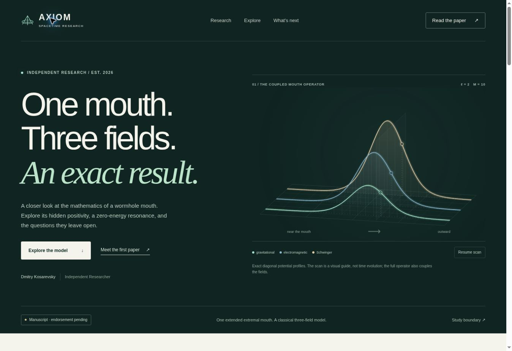

# Blackhole · Axiom Spacetime

Source for the **Axiom Spacetime** research microsite: an animated introduction, an interactive explorer, and a growing manuscript collection.

**Website address:** <https://blackhole.kosarevsky.dev/>  
**Connection status:** HTTPS verified; HTTP redirects to HTTPS.  
**Website repository:** <https://github.com/agent-axiom/blackhole>  
**Research author:** Dmitry Kosarevsky, Independent Researcher · <if.kosarevsky@gmail.com>

This public repository contains the website and selected frozen research artifacts. The original [research repository](https://github.com/agent-axiom/teleport-research) remains private. Publishing this site does not publish that repository or its full development history.

## Research status

As of **22 October 2026**, the first manuscript is *Positive Factorization and a Zero-Energy Resonance of the Schwinger-Coupled Wormhole Mouth*. Its arXiv submission is awaiting `gr-qc` endorsement; there is no announced arXiv identifier. The manuscript has not undergone independent human peer review, and its AI assistance is disclosed.

The article establishes an explicit positive factorization, a unique bounded zero-energy resonance, and a conditional attractive-perturbation binding result for one specified three-channel extremal-mouth operator. Its input is [Sadhukhan, arXiv:2610.09847v1, Eqs. (5.20)–(5.22)](https://arxiv.org/html/2610.09847v1). See the [manuscript](site/papers/paper-01.pdf) and [derivation note](site/papers/paper-01-derivation.md) for the assumptions and proofs.

The interactive chart displays **90 archived classical master-flux calculations**. Its dotted threshold expression is a matching prediction whose uniform matrix threshold proof remains open. The exact-resonance view uses a single fixed normalization of the symmetrized master variables. The hero shows exact diagonal potential profiles; its moving scan is a spatial guide, not time evolution. These results do not establish a teleportation device or physical qubit fidelity.

## Run locally

The site is buildless HTML, CSS and native JavaScript modules. No package installation is required. Python 3 is sufficient for local serving and integrity checks.

```sh
python3 scripts/verify_site.py
python3 -m http.server 8080 --directory site --bind 127.0.0.1
```

Open <http://127.0.0.1:8080/>. Use an HTTP server rather than opening `index.html` as a file: the explorer loads its local JSON through `fetch`.

## Files and provenance

| Path | Purpose |
| --- | --- |
| `site/index.html`, `site/style.css` | Page content, responsive layout and the first featured manuscript. |
| `site/hero.js` | Explanatory canvas animation, including a pause control. |
| `site/explorer.js` | Saved numerical samples and the exact analytic resonance profile. |
| `site/app.js` | Initializes the page and appends later manuscripts from the registry. |
| `site/data/research.json` | Manuscript registry and explicit publication/review status. |
| `site/data/scattering.json` | Display-oriented subset of the archived numerical records; values are copied without rounding. |
| `site/data/scattering.csv` | Original numerical table. |
| `site/data/convergence.json` | Separate solver-tolerance and endpoint-extent refinements. |
| `site/data/provenance.json`, `site/data/solver-manifest.json` | Scope, source revision, original artifact hashes and numerical diagnostics. |
| `site/papers/` | Frozen manuscript, BibTeX entry and derivation note. |
| `scripts/verify_site.py` | Dependency-free artifact, data-consistency and local-link verification. |

The first manuscript and data are associated with research revision:

```text
00bc6243983dfdc3bae3a15345bf73f9db3e6bc2
```

The eight-page `paper-01.pdf` has SHA-256:

```text
625cc7318e702010465003028236e917cff1f3195b8d93809c471d6db2ead4e3
```

The verifier checks the frozen PDF, original CSV and convergence hashes, agreement between the plotted JSON and original CSV, the complete parameter grid, flux bookkeeping, revision metadata, registered manuscript files, and literal local asset links. It does not rerun the private research code, prove the theorems, provide error bounds, or test remote URLs. Browser checks remain necessary after layout or interaction changes.

## Add a later manuscript

1. Add an actual manuscript and its supporting public artifacts under a new, versioned path in `site/papers/`. Research questions without a manuscript belong in the page's open-questions section.
2. Append an entry to `site/data/research.json`, following the existing fields: number, unique slug, title, author, date label, status, summary, local PDF path, page count, source revision and PDF SHA-256. Keep `arxiv_id` null until an identifier is actually issued; record peer review separately.
3. The page automatically appends entries after the first registry item. The first featured article also has static HTML in `site/index.html`, so update that HTML alongside its registry entry when its status changes.
4. Keep the frozen first-paper data intact. New calculations should have their own provenance and files. A revised first-paper release requires an intentional revision/hash update, including the verifier's frozen-release constants.
5. Run the verifier and inspect the page on desktop and mobile before merging.

Keep exact results, numerical evidence and planned work clearly labeled. There is no promised paper count or guaranteed priority claim.

## GitHub Pages

The [Pages workflow](.github/workflows/pages.yml) verifies pull requests and publishes `site/` after a successful check on `main`. A manual run on `main` is also supported. It uses the official [`configure-pages`, `upload-pages-artifact` and `deploy-pages` workflow](https://docs.github.com/en/pages/getting-started-with-github-pages/using-custom-workflows-with-github-pages), without a build step.

In the repository's **Settings → Pages**, select **GitHub Actions** as the publishing source. Configure the canonical domain and its DNS separately. The workflow uploads only `site/`; it does not need access to the private research repository or a personal access token. A successful deployment's URL is recorded in the `github-pages` environment.

### Deployment record · 22 October 2026

The first [verification and deployment](https://github.com/agent-axiom/blackhole/actions/runs/39815739909) succeeded. The live GitHub Pages page was opened and its numerical explorer was checked. Desktop and 375px-wide mobile layouts were inspected before deployment.

### Custom domain connection · 23 October 2026

GitHub Pages is configured for `blackhole.kosarevsky.dev`. Cloudflare serves a DNS-only **CNAME** from `blackhole` to `agent-axiom.github.io`, with TTL **Auto**. The target has no repository path. Public DNS resolves to the GitHub Pages addresses.

The custom-domain HTTPS page and manuscript PDF were verified on 23 October 2026 using normal TLS certificate validation. **Enforce HTTPS** is enabled in GitHub Pages, and the HTTP endpoint returns a **301 redirect to HTTPS**. The PDF SHA-256 matches the frozen release above.

The BibTeX entry, page metadata and sitemap use the canonical HTTPS domain. Follow [GitHub's custom-domain instructions](https://docs.github.com/en/pages/configuring-a-custom-domain-for-your-github-pages-site/managing-a-custom-domain-for-your-github-pages-site) if the hosting configuration changes.



## Reuse

No software or data reuse license has been selected for this repository. Public availability does not supply a blanket reuse license. The manuscript's authorized arXiv distribution license does not license the website code or data; third-party works retain their own licenses.
